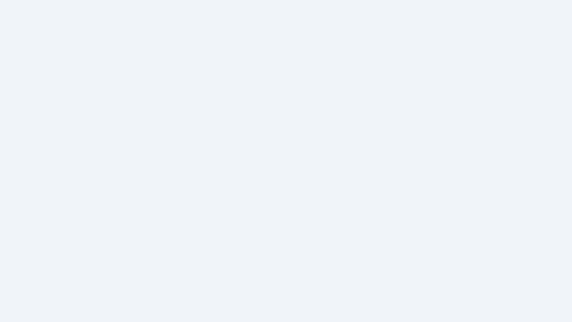
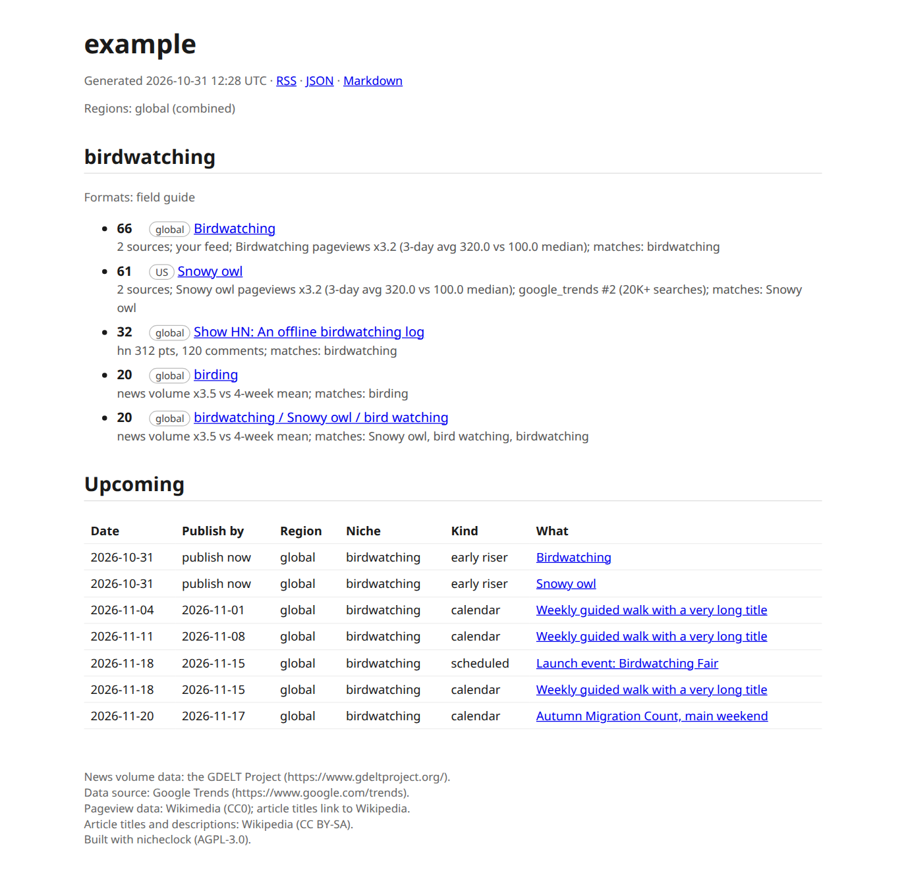

# nicheclock

Rising topics, dated events, and when to publish.

[](https://nicheclock.elmrank.com/video/nicheclock-intro.mp4)

*A loop from the 74-second intro video, silent with captions on screen. Click it for the full video. The tables are the Trending now and Upcoming pages of nicheclock.elmrank.com, captured on 2 Nov 2026.*

nicheclock is a self-hosted trend radar for SEOs who work with AI. It watches signals that tend to move before keyword volume does, such as Wikipedia pageviews, news volume, Hacker News and event calendars, lists the topics that have started to rise, and gives every dated event a publish-by date. Use it next to your keyword research. The MCP server runs locally from this repository.



*The report `nicheclock run` writes, built from recorded test fixtures for a project called `example`. Not live data.*

Give it your site's URL and it proposes one to four niches. You edit them, `nicheclock run` collects signals, and you read the result as an HTML report, a JSON feed, or from your own AI assistant over MCP. Every row carries its sources and evidence. Without a model, rows are ranked by rules. With a model you bring (Claude, OpenAI, Gemini, Ollama, or a Claude Code or Codex sign-in), each row also gets a niche-fit score and a one-sentence reason, and duplicate stories are merged. With Google Search Console connected, it lists queries where you have impressions but no page that covers them, with a suggested angle.

Licensed under the GNU AGPL-3.0-or-later.

## What it does not do yet

- It does not forecast. It shows what is rising now and what is dated ahead.
- It gives no search volume, keyword difficulty or rank tracking, and it does not write articles.
- It is English only: keyword extraction, the bundled background corpus, the interface and the reports.
- It is not on PyPI and there is no prebuilt container image. You install from a checkout.
- Only Google Trends and Apple charts are exact per country. Wikipedia and GDELT are approximate per country, and Hacker News, GitHub and your own feeds have no country. See [docs/regions.md](docs/regions.md).
- The Gemini and Codex providers are unit-tested but have not been run against the real services.
- It is tested on Linux. macOS and Windows may work and are untested.
- The Trending catalog shown on the website is not yet available over MCP. The hosted API and MCP behind nicheclock.elmrank.com have no tool for it yet. The MCP server in this repository runs locally on your machine and reads the data of your own `nicheclock run`.

The full list is in [docs/limitations.md](docs/limitations.md).

## Install

You need Python 3.11 or newer. From a checkout of this repository:

```bash
pipx install '.[gsc,mcp]'     # or: uv tool install '.[gsc,mcp]'
nicheclock init https://your-site.example \
  --user-agent "mysite-radar/1.0 (+mailto:you@your-site.example)" \
  --contact-email you@your-site.example
nicheclock edit               # opens $EDITOR on the generated niches, validates, then saves
nicheclock run
nicheclock serve              # open http://127.0.0.1:8080/
```

nicheclock has no default identity and refuses to fetch until you set a User-Agent and a contact email, because every request to a data source carries them. `init` reads your sitemap and writes `nicheclock.yaml`. `https://example.com` has no sitemap, so use the demo site in [docs/quickstart.md](docs/quickstart.md) to try it first.

The extras are optional: `gsc` for Search Console, `mcp` for the MCP server, `onboard` for scikit-learn (same `init` results, faster counting).

Docker, with one state directory, a healthcheck and a daily run:

```bash
mkdir nicheclock-data && cp .env.example .env
docker compose build
docker compose run --rm nicheclock init https://your-site.example \
  --user-agent "mysite-radar/1.0 (+mailto:you@your-site.example)" --contact-email you@your-site.example
docker compose up -d          # reports on http://127.0.0.1:8080/
```

Details are in [docs/docker.md](docs/docker.md). Nothing is sent anywhere unless you configure it: your identity goes to the data sources, and text goes to a model provider only if you pick one. There is no telemetry.

## MCP over stdio

`nicheclock mcp` starts a read-only MCP server on stdin and stdout. It reads the data of your last `nicheclock run`. It never fetches, never calls a model and never writes. Four tools: `trends_for_niche`, `upcoming`, `gsc_gaps` and `explain_topic`. The last one returns the evidence and a judging prompt, and your assistant's own model does the judging.

```bash
pipx install '.[mcp]'
claude mcp add nicheclock -- nicheclock -c /absolute/path/to/nicheclock.yaml mcp
```

For Claude Desktop, put this in `claude_desktop_config.json`:

```json
{
  "mcpServers": {
    "nicheclock": {
      "command": "/absolute/path/to/nicheclock",
      "args": ["-c", "/absolute/path/to/nicheclock.yaml", "mcp"]
    }
  }
}
```

Use absolute paths: desktop apps start the server from their own working directory. Cursor and the tool arguments are in [docs/mcp.md](docs/mcp.md).

## Data sources and their terms

nicheclock switches on by default only sources whose published terms allow automated use, and each source module links the clause it relies on. One source, Stack Exchange, is built but off until an application key exists (see below). All requests go through one client: your User-Agent, at most one request per second per host, robots.txt respected, `Retry-After` honoured. Per-source options and how to switch each one off are in [docs/sources.md](docs/sources.md).

The catalog behind the website (`python -m nicheclock.catalog build`) keeps a ledger of every source it considered, with the terms it checked. The sources it uses:

| Source | License or terms | What is kept | Default |
|---|---|---|---|
| [Wikimedia pageviews](https://dumps.wikimedia.org/other/pageviews/readme.html) | CC0. Bots must send an accurate User-Agent and honor Retry-After. | Daily views per article. | On. |
| [Wikimedia pageviews per country](https://dumps.wikimedia.org/other/analytics/) | CC0. Differentially private: small counts are suppressed, and nothing is published for China and Russia. | Views per country for pages above the release threshold. | On. |
| [Wikidata](https://www.wikidata.org/wiki/Wikidata:Licensing) | CC0 | Topics, classes and dated events. | On. |
| [GDELT](https://www.gdeltproject.org/about.html) | Free for any use. Cite the GDELT Project and link to it. | Article counts from the 15-minute GKG files. | On. |
| [Hacker News](https://hn.algolia.com/api) | Hacker News API terms (Algolia). | Title, link and points. | On. |
| [YouTube Data API](https://developers.google.com/youtube/terms/developer-policies) | YouTube API Services Terms. Statistics must not be stored for more than 30 days. | Most-popular chart presence and view counts, as YouTube reports them. Not committed to this repository. | On. |
| [holidays](https://github.com/vacanza/holidays) | MIT | Public holidays for ten countries. | On. |
| [Federal Register](https://www.federalregister.gov/developers/documentation/api/v1) | US government work, public domain. Programmatic access through the API only. | US notices, comment deadlines and effective dates. | On. |
| [GitHub REST API](https://docs.github.com/en/site-policy/github-terms/github-terms-of-service) | GitHub API terms. Read-only calls with a token, rate limit respected. The github.com/trending pages are not fetched. | Repository name, description, language, topics, star and fork totals, and our own daily snapshots of them (a window is the difference between snapshots). | On. |
| [GDACS](https://www.gdacs.org/About/termofuse.aspx) | CC BY 4.0, source acknowledged. | Current disaster events with GDACS's own alert level. | On. |
| [TVmaze](https://www.tvmaze.com/api) | CC BY-SA 4.0, attribution by link. | Shows airing today: name, type, language, network, popularity weight, link. | On. |
| [Stack Exchange API](https://api.stackexchange.com/docs) | Content is CC BY-SA and is not copied. The terms require naming the Stack Exchange Network as the source, an application key, and obeying the `backoff` field. | Tag names, counts and a link; every row names the Stack Exchange Network. | Off until a key exists. |
| [Open Library](https://openlibrary.org/developers/api) | Light use with an identifying User-Agent. | Title, authors and link of daily trending works. | On. |

Stack Exchange is built but stays off until an application key is registered on Stack Apps: set `STACKEXCHANGE_KEY` (or put the key in `~/.config/nicheclock/stackexchange.env`) and the Stack Overflow tags channel starts; without a key the catalog reports `pending_key` and makes no request. With a key it makes one request a day and obeys and remembers the API's `backoff`.

The ledger also lists sources that were considered and left out: Nager.Date (non-commercial terms), Apple Marketing Tools RSS (terms unclear), CoinGecko (no commercial rights on the free plan), npm download counts (no reuse statement), PyPI download counts (no licensed list of the most downloaded packages), GH Archive (no stated licence), and TMDB, Spotify charts, Google Play, Baidu and Weibo (no terms that allow reuse). The ledger is [`nicheclock/catalog/data/sources.json`](nicheclock/catalog/data/sources.json), with the quoted clause for each source.

The self-hosted tool reads a slightly different set (Google Trends RSS, Wikipedia, Hacker News, GitHub, Apple charts, GDELT, Federal Register, and the RSS and ICS feeds you list yourself). Its terms table is [docs/sources.md](docs/sources.md). Sources that forbid automated collection, such as Reddit, Product Hunt and Amazon, are not read.

## Documentation

| | |
|---|---|
| [Quickstart](docs/quickstart.md) | Install, init, edit, run, open the report. |
| [Docker](docs/docker.md) | Compose, volumes, schedule, healthcheck, proxy, backup, update. |
| [Configuration](docs/configuration.md), [How init works](docs/onboarding.md) | Every field, per-source options, notifications. |
| [Models](docs/models.md) | Providers, budget, what is and is not sent. |
| [MCP](docs/mcp.md) | Claude Desktop, Claude Code, Cursor. |
| [Search Console](docs/search-console.md) | Read-only OAuth with your own client. |
| [Sources](docs/sources.md), [Regions](docs/regions.md) | Where data comes from and how country-level data works. |
| [Troubleshooting](docs/troubleshooting.md), [FAQ](docs/faq.md), [Limitations](docs/limitations.md), [Roadmap](docs/roadmap.md) | |

The same pages are the documentation on the hosted site. The code of the Cloudflare Worker behind it and the site build are in [hosted/](hosted/README.md).

## Contributing and security

See [CONTRIBUTING.md](CONTRIBUTING.md) and [docs/contributing.md](docs/contributing.md). Report vulnerabilities as described in [SECURITY.md](SECURITY.md), not in a public issue.
