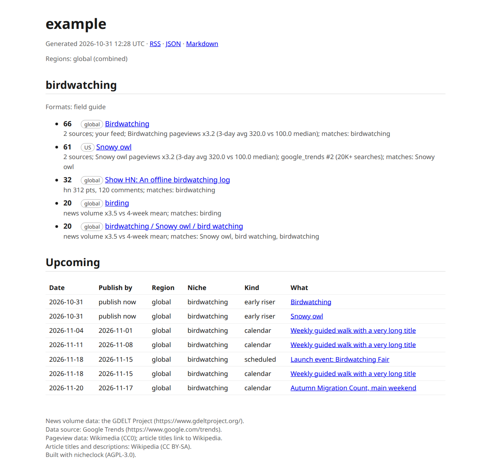

# nicheclock documentation

nicheclock is a self-hosted trend radar for SEOs who work with AI. Keyword volume measures demand that has already happened, and it updates slowly. nicheclock collects signals that often move first (Wikipedia pageviews, news volume, Hacker News, event calendars) from sources that allow automated use, lists topics as they start to rise, and gives every dated event a publish-by date. Each row has its evidence and a model's reason; Search Console adds content gaps with suggested angles. Use it next to your keyword research, not instead of it, from the report or from your assistant over [MCP](mcp.md). It does not forecast: it shows what is rising now and what is dated ahead. Give it your site's URL and it builds an editable list of niches.

*The report `nicheclock run` writes, here from recorded test fixtures (not live data) for a project called `example`.*

## Where to start

| I want to | Read |
|---|---|
| Try it in five minutes | [Quickstart](quickstart.md) |
| Run it on a server, on a schedule | [Docker](docker.md) |
| Understand and edit `nicheclock.yaml` | [Configuration](configuration.md), [How `init` works](onboarding.md) |
| Let a model judge niche fit | [Models](models.md) |
| Ask the radar from Claude, Cursor or another agent | [MCP](mcp.md) |
| Use the hosted API | [API](api.md) |
| Find my site's content gaps | [Search Console](search-console.md) |
| See where the data comes from | [Sources](sources.md) |
| Fix something | [Troubleshooting](troubleshooting.md), [FAQ](faq.md) |
| Read several countries | [Regions](regions.md) |
| Know what is missing | [Limitations](limitations.md), [Roadmap](roadmap.md) |

## How a run works

1. **Collect.** Each source in a niche's `sources:` list produces signals: a trending query, a Hacker News story, a repository, a Wikipedia article that is gaining pageviews, a news-volume spike, an item in a feed you supplied.
2. **Match.** A signal has to match the niche: a keyword or entity must appear, `context:` terms count only next to one of those, and `exclude:` phrases drop an item. A topic must then clear a relevance floor (see [Configuration](configuration.md#how-a-topic-gets-into-the-feed)).
3. **Cluster and score.** Signals from the last 3 days are grouped into topics and scored by recency, list rank, size of the signal and how many independent sources agree. The `why` field of every item spells out the evidence.
4. **Upcoming.** Dated things (comment deadlines, items in your feeds and calendars, Wikipedia articles whose pageviews just started to climb) become events. `publish_by` is the event date minus your index lag: measured from Search Console when you connect it, otherwise `default_lag_days`.
5. **Write.** `feed.json`, `feed.md`, `index.html` and `feed.xml` per project, plus an index page for all projects. Notifications go out if you configured them.

Every request goes through one HTTP client with your identity as User-Agent, at most one request per second per host, robots.txt respected and `Retry-After` honoured. A source that fails is listed at the end of the run and never stops it.

## What it does not do

It does not write articles, scrape sites that forbid it, or promise traffic. A model, when you bring one, judges and explains; collection stays plain code. See [Limitations](limitations.md).

> **Status.** The source code is public. nicheclock is not on PyPI yet, and the hosted API has no public keys. Pages and features that are not released yet carry a Coming tag.
