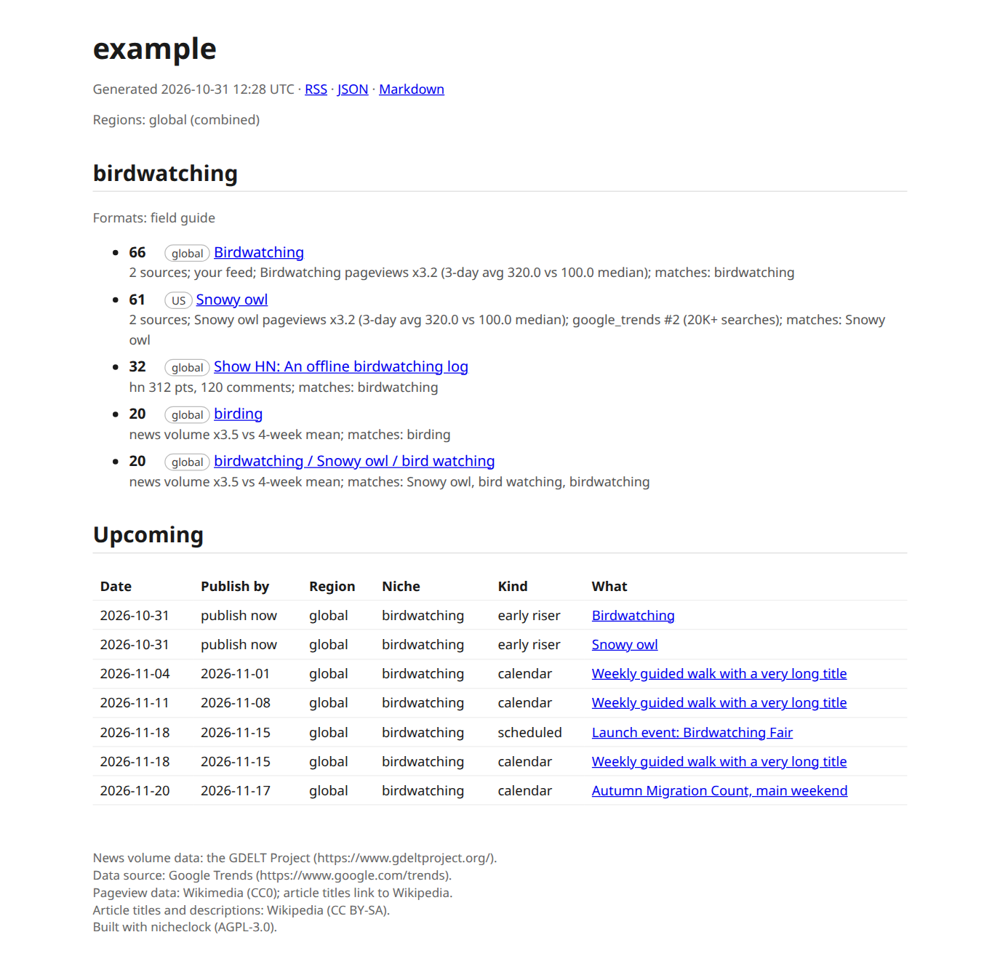

# Quickstart

nicheclock shows SEOs who work with AI which topics are starting to rise and when to publish, from signals that often move before keyword volume does. It complements keyword research and does not replace it. This quickstart takes about five minutes, most of it waiting for `init` to read your site at one request per second.

## 1. Install

You need Python 3.11 or newer. nicheclock is not on PyPI yet, so install from a source checkout:

```bash
pipx install '.[gsc,mcp]'
# or: uv tool install '.[gsc,mcp]'
nicheclock --version
```

The extras are optional: `gsc` for [Search Console](search-console.md), `mcp` for the [MCP server](mcp.md), `onboard` for scikit-learn (gives identical `init` results, only faster counting). Without any extra, `pipx install .` still gives you `init`, `run`, `serve` and the reports.

> **Status.** `pipx install nicheclock` works once the package is published at launch. Until then use the checkout.

## 2. Say who you are

nicheclock refuses to fetch anything without an identity. Every request to every source carries your User-Agent and contact address, so a site owner who sees your traffic can write to you.

```bash
nicheclock init https://your-site.example \
  --user-agent "mysite-radar/1.0 (+mailto:you@your-site.example)" \
  --contact-email you@your-site.example
```

`init` reads your sitemap, samples up to 50 page titles, and writes `nicheclock.yaml` with one to four niches. It takes about half a minute for a small site. Add `--preview` to see what each niche would match before it saves, `--dry-run` to print the config without writing it.

Set the same two values once with `NICHECLOCK_USER_AGENT` and `NICHECLOCK_CONTACT_EMAIL` and you can leave the flags out.

> **Why not `https://example.com`?** example.com has a single page and no sitemap, so `init` stops with `no URLs found, skipping` and writes nothing. That is the correct answer, and the CI job that tests this page checks for it. To try nicheclock without a site of your own, use the demo site below.

### No site of your own: the demo site

The repository ships a tiny fake birdwatching site in `examples/demo-site`. Serve it locally and point `init` at it:

```bash
python3 -m http.server 8099 --bind 127.0.0.1 --directory examples/demo-site &
nicheclock init http://127.0.0.1:8099 --project example \
  --user-agent "nicheclock-demo/1.0 (+mailto:you@example.com)" --contact-email you@example.com
kill %1
```

You get three niches: Feeder, Optics and Field.

## 3. Edit the niches

`init` writes a draft. Open `nicheclock.yaml`, or change it from the command line:

```bash
nicheclock edit --niche "Feeder" --add-keyword "suet cake" --add-exclude cheap
nicheclock edit --niche "Optics" --remove-source gdelt
nicheclock preview --live --limit 5     # what would match today, before you collect anything
```

`nicheclock edit` with no flags opens `$EDITOR`, validates the result and only then saves. Fields are explained in [Configuration](configuration.md). Check the file and your connectivity with:

```bash
nicheclock doctor
```

## 4. Run

```bash
nicheclock run
```

A first run takes one to two minutes: GDELT is limited to one request every ten seconds, and the other sources wait one second between requests. When a source is rate limited, `run` prints it, finishes the others and exits with status 1. The reports are still written, and the queued requests go first next time.

A new, small niche often shows nothing on day one. That is the relevance floor doing its job, not an error; see [Troubleshooting](troubleshooting.md#the-feed-is-empty).

## 5. Open the report

```bash
nicheclock serve            # http://127.0.0.1:8080/
```

Or open `out/<project>/index.html` in a browser; it is one page with a tab per niche, and it opens from disk. The same folder holds `feed.json` (for scripts), `feed.md` (for pasting into notes) and `feed.xml` (for a feed reader).



## Next

- Run it every day on a server: [Docker](docker.md).
- Ask it questions from your editor or Claude: [MCP](mcp.md).
- Let a model judge fit: [Models](models.md) <span class="tag soon">Coming</span>.
